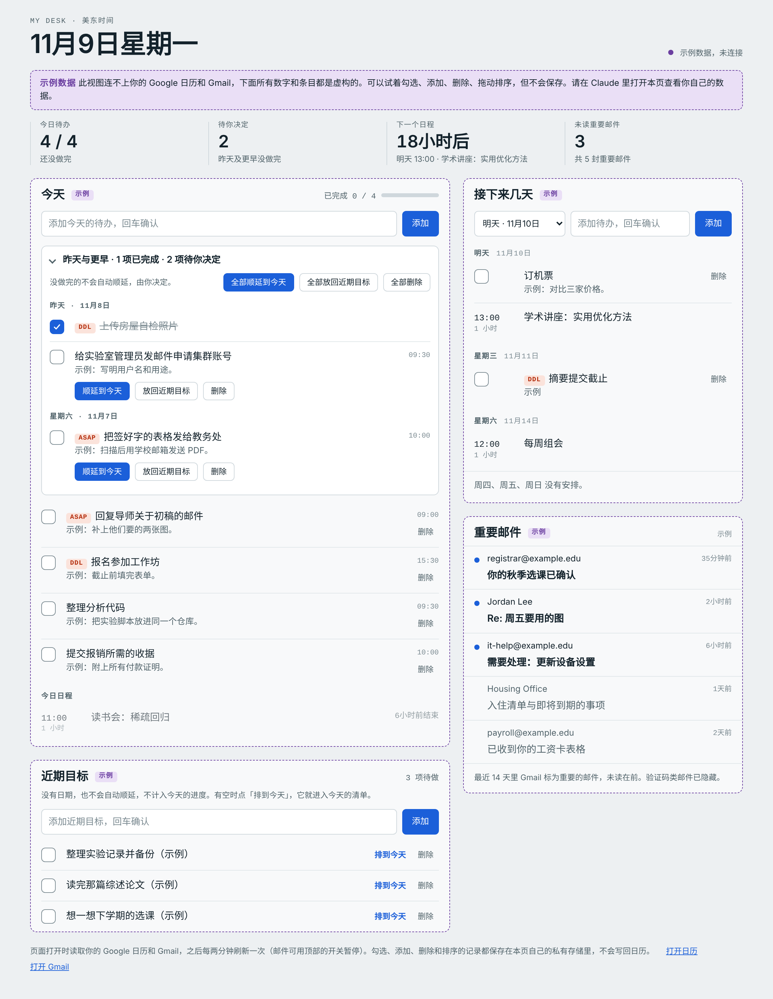

Desk is the page I keep open all day. It reads my Google Calendar and Gmail, turns the calendar into a checklist for today, and keeps a short list of goals that have no date. I built it by talking to Claude, and it lives as a private Claude artifact.

There is no link to my copy, because a desk is personal: mine is set to my time zone, my language and my own tagging habits. What I can share is the recipe, so you can have Claude build yours.

[](/images/desk-sample.png)

*The page with its built-in sample data (everything in this picture is invented). My copy is in Chinese; yours can be in any language.*

### The ideas worth copying

**The calendar is the to-do list.** I already put small tasks into Google Calendar as 30-minute events, often with a tag in front such as `【ASAP】` or `【DDL】`. Desk treats a plain event that has a tag or a description as a to-do with a checkbox. Anything with other attendees, a location, a meeting link or a repeat rule stays a normal event. One click moves an item from one group to the other, and the page remembers the choice for that whole event series.

**Nothing rolls over on its own.** Unfinished items from yesterday do not move silently into today. They wait in a "yours to decide" block at the top, and for each one I pick: carry it to today, put it back into goals, or delete it. This one rule is what keeps the list honest.

**Goals have no date.** "Near-term goals" is a second list for things that matter but are not due on a day. They never roll over and do not count toward today's progress. When I have time, "schedule for today" moves one into today's list.

**Everything can be undone.** Deleting hides an item and offers an undo; deleted items stay recoverable for two weeks. Checking, adding, deleting and reordering are saved in the page's own private storage, and nothing is ever written back to the calendar.

**Mail is a side panel.** It shows the threads Gmail marked important in the last 14 days, unread first, with verification-code mail hidden. A switch turns automatic mail refresh off when I do not want the inbox in view.

### Build your own

You need a Claude plan that can publish artifacts, with the Google Calendar and Gmail connectors turned on. Then paste the prompt below into Claude and fill in the brackets.

```text
Build me a personal dashboard as an artifact, called
"[NAME]'s Desk".
Interface language: [LANGUAGE]. Time zone: [IANA TIME ZONE,
e.g. Europe/Berlin].

Data
- Read my Google Calendar (7 days back, 7 days ahead) and my
  Gmail (important inbox threads from the last 14 days).
  Refresh every two minutes.
- Read-only: never write to the calendar or to Gmail.
- Save my own state (done marks, added items, order,
  preferences) in the page's private per-viewer storage.
- If the page cannot reach my data, show clearly labelled
  sample data instead of an empty page.

To-dos come from the calendar
- An event counts as a to-do when it is plain (no other
  attendees, no location, no meeting link, not recurring)
  and has a tag or a description. Everything else is a
  normal event.
- A tag is a short prefix in brackets in the event title,
  such as [MY TAGS, e.g. 【ASAP】 or [DDL]]. Show it as a
  chip, and highlight urgent ones (asap, ddl, due, urgent,
  deadline).
- Give every item a "make this a to-do" / "make this an
  event" button and remember the choice for the whole event
  series.

Layout
- A header with today's date and four numbers: to-dos left
  today, items waiting for my decision, time until the next
  event, unread important mail.
- Today: a checklist with a progress bar and a box to add a
  to-do, then today's events with "in 2 hours" / "now" /
  "ended" labels.
- Yesterday and earlier: unfinished to-dos never roll over
  on their own. Show them in a block at the top of Today
  with three choices per item: carry to today, put back into
  goals, delete. Add "all" buttons as well.
- Near-term goals: a separate list with no dates. Goals
  never roll over and do not count toward today's progress.
  Each has a "schedule for today" button.
- Next days: the coming six days, to-dos first and then
  timed events, with a box to add a to-do to a chosen day.
- Important mail: sender, subject and age, unread first,
  verification-code mail hidden, with a switch that pauses
  automatic mail refresh and a "read once" button while it
  is paused.

Behaviour
- Delete is not the same as done: a deleted item leaves the
  list, can be undone from a toast, and stays in a "deleted"
  drawer for 14 days.
- Let me reorder to-dos by dragging, and by keyboard.
- Make it work on a phone, in light and dark mode.
```

Expect a few rounds of "move this", "rename that". That back and forth is where the page becomes yours; most of the rules above came from me using an early version for a week and noticing what annoyed me.

For a closer match, you can also give Claude the source of my page as a reference and ask it to adapt it: [desk-template.html](/files/desk-template.html). It holds layout and logic only, with invented sample data and no data of mine. It is written for Claude's artifact runtime, so opened as a plain file in a browser it only shows the sample view.
